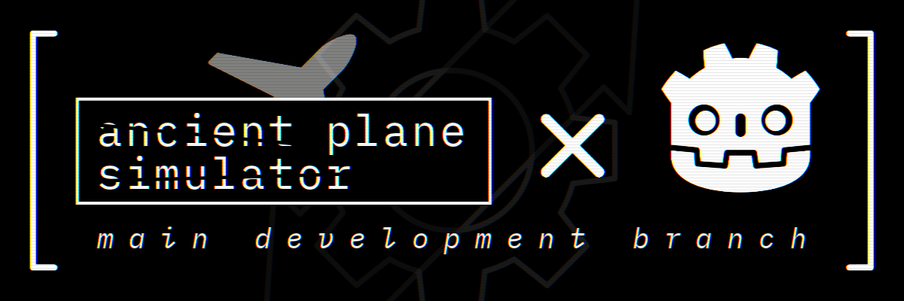
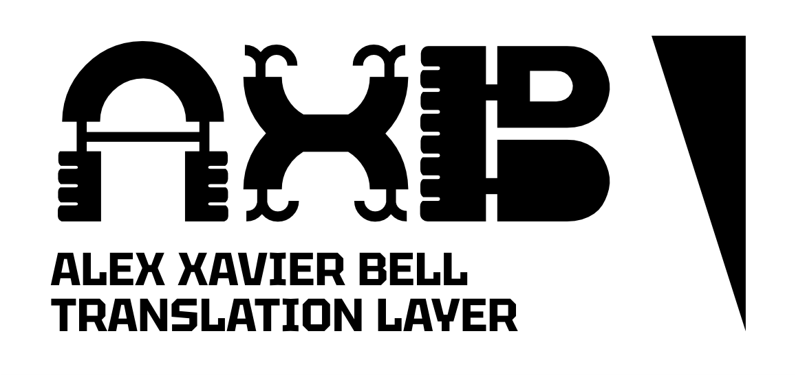

> [!CAUTION]
> **The HTML version of Ancient Plane Simulator is discontinued.**
> Development has moved to the Godot version of the game, which this repository contains. The HTML build no longer receives updates or support.


# Ancient Plane Simulator (2026-2027)

Welcome to the Ancient Plane Simulator main development page.

Ancient Plane Simulator began as a self-contained HTML game (Three.js and canvas) and is now being rebuilt in the **Godot Engine 4.7**. This is the main development branch, so expect frequent changes and the occasional broken build.

## About the game

Pilot an ancient airliner over a Nile-valley landscape of pyramids, cities and sandstorms, all from a fully clickable cockpit. Between flights, the game wraps you in a fake desktop OS (**albionOS**), a handheld PDA and a walkable nuclear plant campus. Several endings are hidden in the game, and not all of them involve landing safely.

## Features

- **Flight model and cockpit:** realistic-feeling controls, 16 working instruments, autopilot, auto take-off and autoland.
- **Aircraft systems:** fuel tanks with leaks, engine start and flameout, electrics, APU, hydraulics, pitot and window heat, and airframe integrity.
- **Hazards:** sandstorms with debris, display black-outs and glitches, and fuel-exhaustion or structural-failure endings.
- **World:** terrain, the Nile, cities, pyramids, a sphinx, clouds and multiple airfields (JRNA, NCLR, LMIA and MASTER KING).
- **albionOS desktop:** file explorer, forum browser, audio player, scripted chat, Minesweeper, text editor and settings.
- **PDA:** item storage, mail, web pages, a log and a system page.
- **NAICOL REACTOR campus:** explore on foot, use live SCADA control screens, drive the site truck, and pick up and throw props.
- **Multiple endings,** including a secret one, saved between sessions.

## Status

🚧 Work in progress. The port is largely complete, and the current focus is the remaining pieces that are still simplified compared with the original HTML version:

- the secret-ending cinematic
- cockpit damage visuals
- the PDA boot animation and map page
- the albionOS CRT and scanline effects

## Getting started

1. Install [Godot 4.7](https://godotengine.org/download).
2. Clone this repository:

   ```bash
   git clone https://github.com/minhclark-official/ancient-plane-simulator.git
   ```

3. Open Godot, click **Import**, and select the project folder.
4. Press **F5** to run. The main scene is `res://scenes/main.tscn`.

## Controls

| Key | Action |
|-----|--------|
| W / S | Pitch |
| A / D | Roll |
| Q / E | Rudder |
| R / F | Thrust |
| G | Landing gear |
| [ / ] | Flaps |
| P / B | Park brake / wheel brake |
| T | Auto take-off |
| K | Arm autoland |
| J | Switch destination |
| V | Autopilot |
| X | Time acceleration |
| N | Map range |
| I | PDA |
| O | Overhead panel |
| Space / Esc | Pause menu |
| M | Mute |
| H | Help |

The cockpit is also clickable: drag the yoke and thrust levers with the mouse.

## Project structure

| Folder | Contents |
|--------|----------|
| `scenes/` | Game screens and worlds (flight, menu, PDA, SCADA, albionOS, etc.) |
| `scripts/` | Game logic: flight model, aircraft systems, OS, UI and autoloads |
| `assets/` | Audio, sprites, fonts, baked campus scene and terrain data |
| `tools/` | Baking scripts and headless test and screenshot tools |

## Powered by AXBTL

<p align="center">
  
</p>

Ancient Plane Simulator is powered by the **Alex Xavier Bell Translation Layer (AXBTL)**, a proprietary Godot layer developed by JNX03 (with some help from Thomas Clark) built specifically for the game's assets, with room to support other projects in the future.

## Credits

- Created by Thomas Clark ([@minhclark-official](https://github.com/minhclark-official))
- Co-developed with JNX03, HmonWutt & AzureNightlock
- Built with [Godot Engine](https://godotengine.org)
- Powered by the Alex Xavier Bell Translation Layer (AXBTL)

## License

No license has been granted for this project. Unless stated otherwise, **all rights are reserved**. The source is public for viewing only, and you may not copy, modify or redistribute it without permission.
